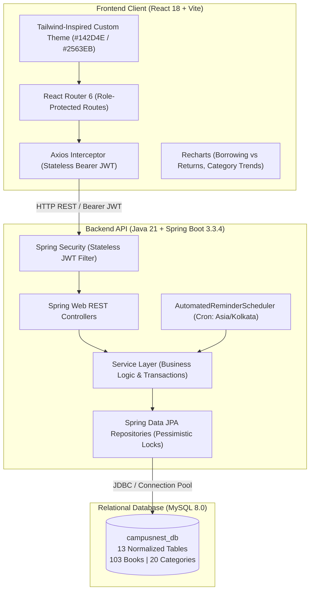

# CampusNest — Smart Library and Academic Management System

> **Your Books. Your Campus. Your Progress.**

[](https://www.oracle.com/java/technologies/downloads/#java21)
[](https://spring.io/projects/spring-boot)
[](https://reactjs.org/)
[](https://vitejs.dev/)
[](https://www.mysql.com/)
[](https://opensource.org/licenses/MIT)

**CampusNest** is an enterprise-grade, full-stack college library and academic project management portal built with **Java 21, Spring Boot 3.3.4, Spring Security, Hibernate/JPA, MySQL 8, and React 18 (Vite)**. Designed for higher-education campuses, it unifies library circulation, automated overdue fines, concurrency-safe inventory tracking, academic project deadlines, and student submissions into an intuitive single pane of glass.

---

## 🏛️ System Architecture

CampusNest follows a decoupled client-server architecture with stateless JWT security, pessimistic database locking for concurrency control, and automated scheduling for campus notifications.



---

## ✨ Key Features & Business Workflows

### 1. Concurrency-Safe Circulation Desk
- **Pessimistic Locking (`PESSIMISTIC_WRITE`):** Guarantees zero race conditions when multiple patrons attempt to check out the final available copy of high-demand textbooks simultaneously.
- **Role Borrow Limits:** Configurable max borrow duration (14 days for students, 30 days for faculty) and quota enforcement (3 books for students, 5 for faculty).

### 2. Automated Fine Calculation & Payment Auditing
- **Late Fee Accrual:** Automatic fee accumulation (default ₹5.00/day) computed from the midnight following the due date.
- **Flexible Fine Payments:** Supports partial or full fine clearance by librarians with unique receipt numbers (`REC-...`), date timestamps, and printable payment receipts.

### 3. Automated Scheduling & Proactive Reminders
- **Spring `@Scheduled` Engine:** Runs daily with time-zone awareness (`Asia/Kolkata`).
- **2-Day Early Warning:** Automatically detects books due within 48 hours and generates high-priority inbox reminders for students and faculty.
- **Overdue Alerts:** Instantly transitions expired loans to `OVERDUE`, creates daily fine ledgers, and dispatches disciplinary notifications.
- **Idempotent Prevention:** Internal tracking ensures patrons receive exactly one reminder per deadline cycle.

### 4. Academic Projects & Assignment Submissions
- Faculty create department-wide course projects with target submission deadlines.
- Students upload their project deliverables (GitHub repository links, drive links, and implementation notes).
- Faculty view live submission feeds, download links, and grade/review student submissions in real time.

### 5. First-Time Login Password Security
- Students are initialized with their Date of Birth (`DDMMYYYY`) as their initial credential.
- Upon first successful authentication, a mandatory security modal intercepts navigation, requiring a custom strong password change before granting dashboard access.

---

## 👥 User Roles & Access Control

CampusNest implements strict role-based authorization across all backend REST endpoints and frontend view states:

| Role | Access Scope | Key Capabilities |
| :--- | :--- | :--- |
| **Admin / Librarian** | Whole Campus | Issue/Return books, manage 103-book catalog, manage students & faculty, collect fines & issue receipts, trigger manual scheduler runs, export audit reports. |
| **Student** | Personal Academic Portal | Browse 20 book categories, check out books, track return countdowns, view pending fines, submit course projects, receive return reminders. |
| **Faculty** | Department Portal | Browse library catalog, extended 30-day borrowing, create class projects & assignments, review & grade student project submissions. |

---

## 🔑 Demo Accounts & Seed Credentials

The database comes pre-seeded with 8 verified accounts ready for immediate demonstration:

| Role | Username | Initial Password | Description |
| :--- | :--- | :--- | :--- |
| **Admin** | `admin` | `AdminPassword123!` | Head Librarian with complete administrative privileges |
| **Student** | `STU2026001` | `15082006` *(DOB)* or `StudentPassword123!` | Arjun Sharma (Computer Science, Year 3) |
| **Student** | `STU2026002` | `22112005` *(DOB)* or `StudentPassword123!` | Priya Patel (Electronics, Year 3) |
| **Student** | `STU2026003` | `10042006` *(DOB)* or `StudentPassword123!` | Rohan Verma (Information Technology, Year 2) |
| **Faculty** | `FAC2026001` | `FacultyPassword123!` | Dr. Rajesh Kumar (Professor, Computer Science) |
| **Faculty** | `FAC2026002` | `FacultyPassword123!` | Prof. Sunita Rao (Associate Professor, Electronics) |

*(Note: On the login page, handy **One-Click Demo Login** pill buttons are provided to instantly populate credentials for Admin, Arjun, Priya, and Dr. Rajesh).*

---

## 📚 Seeded Book Catalogue (103 Books, 20 Categories)

The system is pre-populated with **103 classic and contemporary engineering, science, and literature titles** across 20 distinct academic categories:

1. **Computer Science & Engineering** (Clean Code, Design Patterns, Algorithms, Modern OS)
2. **Artificial Intelligence & Machine Learning** (Hands-On ML, Deep Learning, AI: Modern Approach)
3. **Data Science & Big Data** (Python for Data Analysis, Designing Data-Intensive Applications)
4. **Web Technologies & Cloud Computing** (Full Stack React, Cloud Native Patterns)
5. **Cybersecurity & Cryptography** (The Web Application Hacker's Handbook, Applied Cryptography)
6. **Electronics & Communication Engineering** (Microelectronic Circuits, Digital Signal Processing)
7. **Electrical & Electronics Engineering** (Electric Machinery Fundamentals, Power System Analysis)
8. **Mechanical Engineering** (Shigley's Mechanical Engineering Design, Heat & Mass Transfer)
9. **Civil & Structural Engineering** (Design of Reinforced Concrete, Soil Mechanics)
10. **Information Technology** (Computer Networks: Top-Down Approach, Database System Concepts)
11. **Mathematics & Statistics** (Higher Engineering Mathematics, Linear Algebra & Its Applications)
12. **Physics & Materials Science** (Concepts of Modern Physics, Materials Science and Engineering)
13. **Chemistry & Environmental Engineering** (Engineering Chemistry, Environmental Engineering)
14. **Management & Business Studies** (Principles of Management, Organizational Behavior)
15. **Humanities & Soft Skills** (Technical Communication, Effective Speaking & Presentation)
16. **Literature & Fiction** (To Kill a Mockingbird, 1984, The Great Gatsby)
17. **General Science & Research Methodology** (Research Methodology, The Structure of Scientific Revolutions)
18. **Biomedical & Biotechnology** (Biomedical Instrumentation, Molecular Biology of the Cell)
19. **Robotics & Automation** (Introduction to Robotics: Mechanics & Control, Industrial Automation)
20. **Reference & Competitive Exams** (GATE Computer Science, Quantitative Aptitude for Competitive Examinations)

---

## 🛠️ Technology Stack Breakdown

### Frontend
- **Framework:** React 18.3 with Vite 5.4 build tool
- **Routing:** React Router DOM 6.26
- **HTTP Client:** Axios 1.7 with Bearer Token interceptor
- **Icons:** Lucide React (Clean, modern SVG iconography)
- **Visual Analytics:** Recharts 2.12 (Responsive bar charts, pie charts, and monthly trends)
- **Styling:** Custom CSS design system adhering to the official CampusNest corporate palette:
  - Deep Navy: `#142D4E`
  - Slate Blue: `#2563EB`
  - Emerald Teal: `#0F9D8A`
  - Light Background: `#F5F7FB`
  - Dark Charcoal: `#172033`
  - Amber Warning: `#D97706`
  - Crimson Error: `#DC2626`

### Backend
- **Language:** Java 21 (LTS)
- **Framework:** Spring Boot 3.3.4
- **Security:** Spring Security 6.3 with JJWT 0.12.6 stateless token validation
- **Persistence:** Spring Data JPA / Hibernate 6 with connection pooling
- **Validation:** Jakarta Bean Validation (`@NotBlank`, `@Min`, `@Pattern`)
- **Automated Scheduling:** Spring `@EnableScheduling` with `cron = "0 0 0 * * *"` (`Asia/Kolkata`)
- **Unit & Integration Testing:** JUnit 5, Mockito, AssertJ

### Database
- **Engine:** MySQL 8.0+
- **Schema:** 13 fully normalized relational tables (`users`, `roles`, `students`, `faculty`, `categories`, `books`, `borrow_transactions`, `fines`, `fine_payments`, `projects`, `project_submissions`, `notifications`, `library_settings`)
- **Integrity:** Strict Foreign Key constraints (`ON DELETE RESTRICT`), unique indexes (`isbn`, `registration_number`, `employee_id`), check constraints, and `DECIMAL(10,2)` financial types.

---

## 🚀 Getting Started Locally

### Prerequisites
- **Java Development Kit (JDK):** Version 21 or higher installed (`java -version`)
- **Apache Maven:** Version 3.9+ (`mvn -version`)
- **Node.js & npm:** Version 20+ and npm 10+ (`node -v`, `npm -v`)
- **MySQL Server:** Version 8.0+ running on port 3306

---

### Step 1: Database Setup
1. Open your MySQL client (Command Line or MySQL Workbench) and execute the schema script:
   ```bash
   mysql -u root -p < database/schema.sql
   ```
2. Populate the 103 books, categories, and demo user accounts:
   ```bash
   mysql -u root -p campusnest_db < database/sample-data.sql
   ```

---

### Step 2: Backend Configuration & Run
1. Navigate to the backend directory:
   ```bash
   cd backend
   ```
2. Review `src/main/resources/application.properties` (or copy `.env.example` to `.env`):
   ```properties
   spring.datasource.url=jdbc:mysql://localhost:3306/campusnest_db?useSSL=false&allowPublicKeyRetrieval=true&serverTimezone=Asia/Kolkata
   spring.datasource.username=root
   spring.datasource.password=root
   app.jwt.secret=campusnest_super_secret_jwt_signing_key_2026_at_least_256_bits_long!
   ```
3. Run the automated test suite to verify all business rules:
   ```bash
   mvn test
   ```
4. Start the Spring Boot application:
   ```bash
   mvn spring-boot:run
   ```
   *The backend will boot on `http://localhost:8080`.*
   *Verify API health by visiting `http://localhost:8080/api/health`.*

---

### Step 3: Frontend Configuration & Run
1. Open a new terminal and navigate to the frontend directory:
   ```bash
   cd frontend
   ```
2. Install dependencies:
   ```bash
   npm install
   ```
3. Start the Vite development server:
   ```bash
   npm run dev
   ```
   *The application portal is accessible at `http://localhost:5173`.*

---

### ⚡ One-Click Windows Launchers
For Windows users, two automated command batch scripts are provided in the repository root:
- **`start-local.bat`:** Validates MySQL port 3306, launches the Spring Boot JAR on port 8080 in a dedicated console, and starts Vite on port 5173.
- **`stop-local.bat`:** Gracefully terminates all background development server processes listening on ports 8080 and 5173.

---

## 🐳 Docker & Container Deployment

Run the complete multi-tier stack (MySQL 8 + Spring Boot + React/Nginx) with a single command using Docker Compose:

```bash
docker-compose up --build -d
```

### Container Endpoints:
- **Web Application Portal:** `http://localhost:3000`
- **Spring Boot REST API:** `http://localhost:8080/api`
- **MySQL Container:** `localhost:3306`

To shut down containers and preserve database volumes:
```bash
docker-compose down
```

---

## 📡 REST API Reference

All protected endpoints require an `Authorization: Bearer <token>` header obtained from `/api/auth/login`.

### Authentication (`/api/auth`)
| Method | Endpoint | Access | Description |
| :--- | :--- | :--- | :--- |
| `POST` | `/api/auth/login` | Public | Authenticate user & return JWT token + role payload |
| `POST` | `/api/auth/first-login-change-password` | Authenticated | Mandatory first login password update |
| `POST` | `/api/auth/change-password` | Authenticated | Change active account password |
| `GET` | `/api/auth/me` | Authenticated | Retrieve authenticated user profile |

### Book Catalogue (`/api/books` & `/api/categories`)
| Method | Endpoint | Access | Description |
| :--- | :--- | :--- | :--- |
| `GET` | `/api/books` | Authenticated | Search books by keyword, category ID, and availability |
| `GET` | `/api/books/{id}` | Authenticated | Get book details by ID |
| `POST` | `/api/books` | Admin | Register a new book with ISBN and physical copies |
| `PUT` | `/api/books/{id}` | Admin | Update book metadata and shelf location |
| `DELETE` | `/api/books/{id}` | Admin | Remove book title |
| `GET` | `/api/categories` | Authenticated | List all 20 book categories with title counts |

### Borrowing & Returns (`/api/borrow`)
| Method | Endpoint | Access | Description |
| :--- | :--- | :--- | :--- |
| `POST` | `/api/borrow/issue` | Admin | Issue physical book copy to Student or Faculty |
| `POST` | `/api/borrow/return/{id}` | Admin | Process book return & calculate late fee |
| `GET` | `/api/borrow/active` | Admin | List all currently issued active books |
| `GET` | `/api/borrow/overdue` | Admin | List all books exceeding return deadline |
| `GET` | `/api/borrow/my-books` | Student/Faculty | List currently borrowed books for authenticated user |
| `GET` | `/api/borrow/my-history` | Student/Faculty | List borrowing history for authenticated user |

### Fines & Payments (`/api/fines`)
| Method | Endpoint | Access | Description |
| :--- | :--- | :--- | :--- |
| `GET` | `/api/fines/outstanding` | Admin | List all pending fines across the college |
| `GET` | `/api/fines/my-fines` | Student/Faculty | View fine ledgers for authenticated user |
| `POST` | `/api/fines/{id}/pay` | Admin | Record fine collection & generate receipt |

### Academic Projects (`/api/projects`)
| Method | Endpoint | Access | Description |
| :--- | :--- | :--- | :--- |
| `GET` | `/api/projects` | Authenticated | List active projects and assignments |
| `POST` | `/api/projects` | Faculty/Admin | Create a new project with deadline date |
| `POST` | `/api/projects/{id}/submit` | Student | Submit project repo link and documentation |
| `GET` | `/api/projects/{id}/submissions` | Faculty/Admin | Review all student submissions for a project |
| `POST` | `/api/projects/submissions/{id}/review`| Faculty/Admin | Review and grade a submission |

### Dashboards & Reports
| Method | Endpoint | Access | Description |
| :--- | :--- | :--- | :--- |
| `GET` | `/api/admin/dashboard` | Admin | Live KPI counters, borrow/return trends, charts |
| `GET` | `/api/student/dashboard` | Student | Upcoming book deadlines, fine summary, assignments |
| `GET` | `/api/faculty/dashboard` | Faculty | Borrowed books, active course projects, submissions |
| `GET` | `/api/reports/circulation-summary` | Admin | Total books, active loans, fines collected |
| `POST` | `/api/settings/trigger-scheduler` | Admin | Manually trigger automated reminder cron job |

---

## 🌐 Production Cloud Deployment Guide

### Option 1: Frontend on Vercel / Netlify
1. Connect your GitHub repository (`https://github.com/vaibhavvarshith/campusnest`).
2. Set **Root Directory** to `frontend`.
3. Set **Build Command** to `npm run build`.
4. Set **Output Directory** to `dist`.
5. Add the Environment Variable:
   ```ini
   VITE_API_URL=https://your-backend-domain.com/api
   ```
6. Add single-page application rewrite rule in `frontend/public/_redirects`:
   ```
   /*    /index.html   200
   ```

### Option 2: Java 21 Backend on Render / Railway
1. Create a **Web Service** pointing to the repository.
2. Select **Root Directory:** `backend`.
3. Runtime: **Docker** (utilizing `backend/Dockerfile`) or **Java 21 Maven Build**:
   - Build Command: `mvn clean package -DskipTests`
   - Start Command: `java -jar target/campusnest-backend-1.0.0.jar`
4. Set Environment Variables:
   ```ini
   SPRING_DATASOURCE_URL=jdbc:mysql://<cloud-db-host>:3306/<cloud-db-name>?useSSL=true&serverTimezone=Asia/Kolkata
   SPRING_DATASOURCE_USERNAME=<db_user>
   SPRING_DATASOURCE_PASSWORD=<db_password>
   JWT_SECRET=super_secret_production_key_minimum_256_bits_length!
   PORT=8080
   ```

### Option 3: Cloud MySQL on Aiven / PlanetScale / AWS RDS
1. Provision a MySQL 8.0 instance.
2. Import the database schema and sample data:
   ```bash
   mysql -h <remote-host> -P 3306 -u <remote-user> -p <remote-db> < database/schema.sql
   mysql -h <remote-host> -P 3306 -u <remote-user> -p <remote-db> < database/sample-data.sql
   ```

---

## 🧪 Testing & Verification

CampusNest features comprehensive unit and integration tests covering circulation logic, concurrency locking, fine accrual, and scheduling:

```bash
cd backend
mvn test
```

### Verified Test Suites:
- **`FineCalculationTest`:** Validates ₹0 fee on on-time returns, daily overdue accrual (₹5/day), and partial receipt reconciliation.
- **`BorrowServiceTest`:** Validates pessimistic inventory decrement, max borrowing quota checks, and error dispatching on zero copies.
- **`AutomatedReminderSchedulerTest`:** Verifies 2-day advance warning notification dispatch and idempotent execution.
- **`AuthControllerTest`:** Verifies JWT token generation and first-time password reset validation.

---

## 📄 License & Attribution

Developed by **Vaibhav Varshith**  
GitHub: [https://github.com/vaibhavvarshith](https://github.com/vaibhavvarshith)  
Project Repository: [campusnest](https://github.com/vaibhavvarshith/campusnest)  
Licensed under the [MIT License](LICENSE).
